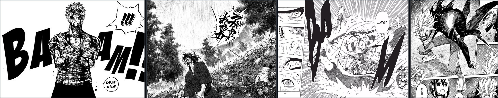

<table align="center" cellspacing="0" cellpadding="0">
<tr>
  <td align="center">
    
  </td>
</tr>
</table>

 

 
  
   
  

  

<!-- ================= ABOUT ME ================= -->
<table align="center" width="100%" cellspacing="0" cellpadding="0">
<tr>
  <td colspan="2">
      
  </td>
</tr>
<tr>
  <td width="78%" valign="top" style="padding: 20px;">
    <h3><i>Kon'nichiwa! (こんにちは) ⚔️</i></h3>
    

      Sou o <b>Matheus Henrique</b>, desenvolvedor de software focado no ecossistema <b>TypeScript / JavaScript</b>, engenharia full-stack, interfaces reativas e gráficos 3D interativos com <b>Three.js</b>, além de plataformas corporativas de <b>IA Generativa & RAG Text-to-SQL</b>.
    

    

      Inspirado na disciplina de <b>Vagabond</b>, na determinação inegociável de <b>One Piece</b>, na resiliência de <b>Naruto</b> e na energia de <b>Dandadan</b>: cada linha de código é lapidada com rigor, cada commit é um passo de evolução técnica e cada bug é superado com consistência.
    

    

      📍 <i>Leopoldina, Minas Gerais — Brasil</i>
    

  </td>
  <td width="22%" align="center" valign="middle" style="padding: 20px;">
    
  </td>
</tr>
</table>

  

<!-- ================= CURRENT PROJECTS ================= -->
<table align="center" width="100%" cellspacing="0" cellpadding="0">
<tr>
  <td colspan="2">
    
  </td>
</tr>
<tr>
  <td width="50%" valign="top" style="padding: 20px;">
    <h3>🎴 Yu-Gi-Oh! Duelist Kingdom Engine</h3>
    
<b>Simulador Tático de Duelos 3D & Deck Builder Retrô</b>

    

      Inspirado no arco clássico do <i>Reino dos Duelistas</i> e no cultuado <i>Forbidden Memories (PS1)</i>. Arena 3D em tempo real com WebGPU/WebGL2, máquina de estados para turnos de duelo, janela de prioridade de armadilhas e 181 testes unitários aprovados com Vitest.
    

    

      <b>Arsenal:</b> 
      <code>TypeScript</code> • <code>React 18</code> • <code>Three.js (WebGPU/WebGL)</code> • <code>Supabase</code> • <code>Howler.js</code> • <code>Vitest</code>
    

    

      👉 <a href="https://github.com/Mathz36/yugioh"><b>🔗 Ver Repositório do Yu-Gi-Oh! →</b></a>
    

  </td>
  <td width="50%" valign="top" style="padding: 20px;">
    <h3>🛡️ Gideon — Sankhya ERP AI</h3>
    
<b>IA Generativa Corporativa & RAG Text-to-SQL</b>

    

      Plataforma corporativa integrada diretamente ao banco de dados do <b>Sankhya ERP</b>. Interpreta linguagem natural e decifra dados complexos em consultas SQL seguras no PostgreSQL em tempo real via streaming SSE com geração de dashboards analíticos.
    

    

      <b>Arsenal:</b> 
      <code>Google Gemini API</code> • <code>Node.js</code> • <code>Express</code> • <code>TypeScript</code> • <code>Prisma ORM</code> • <code>PostgreSQL</code> • <code>React 19</code>
    

    

      👉 <a href="https://github.com/Mathz36/GIDEON"><b>🔗 Ver Repositório do Gideon →</b></a>
    

  </td>
</tr>
</table>

  

<!-- ================= FAVORITE ANIMES & MANGAS ================= -->
<table align="center" width="100%" cellspacing="0" cellpadding="0">
<tr>
  <td colspan="2">
    
  </td>
</tr>
<tr>
  <td width="64%" valign="top" style="padding: 20px;">
    <h3>📺 Animes Favoritos</h3>
    <table cellspacing="8" cellpadding="0">
      <tr>
        <td align="center" valign="top">
           
          <b>One Piece</b>
        </td>
        <td align="center" valign="top">
           
          <b>Naruto</b>
        </td>
        <td align="center" valign="top">
           
          <b>Neverland</b>
        </td>
        <td align="center" valign="top">
           
          <b>Kimetsu</b>
        </td>
        <td align="center" valign="top">
           
          <b>Blue Exorcist</b>
        </td>
      </tr>
    </table>
  </td>
  <td width="36%" valign="top" style="padding: 20px;">
    <h3>📖 Mangás Favoritos</h3>
    <table cellspacing="8" cellpadding="0">
      <tr>
        <td align="center" valign="top">
           
          <b>Vagabond</b>
        </td>
        <td align="center" valign="top">
           
          <b>Dandadan</b>
        </td>
      </tr>
    </table>
     
    

      <i>"O traço cru a nanquim, as hachuras manuais e as jornadas de superação refletem a disciplina no código."</i>
    

  </td>
</tr>
</table>

  

<!-- ================= TECH STACK ================= -->
<table align="center" width="100%" cellspacing="0" cellpadding="0">
<tr>
  <td>
    
  </td>
</tr>
<tr>
  <td align="center" style="padding: 20px;">
    

      
      
      
      
      
      
      
      
    

    

      
      
      
      
      
      
      
    

    

      
      
      
      
      
      
      
    

  </td>
</tr>
</table>

  

<!-- ================= GITHUB STATS ================= -->
<table align="center" width="100%" cellspacing="0" cellpadding="0">
<tr>
  <td>
    
  </td>
</tr>
<tr>
  <td align="center" style="padding: 24px;">
    

      
    

     
    

      
    

     
    

      
    

     
    

      
    

  </td>
</tr>
</table>

  

  

<!-- ================= SOCIALS ================= -->
<table align="center" width="100%" cellspacing="0" cellpadding="0">
<tr>
  <td>
    
  </td>
</tr>
<tr>
  <td align="center" style="padding: 24px;">
    

      
      &nbsp;
      
      &nbsp;
      
      &nbsp;
      
    

  </td>
</tr>
</table>

 

  
<i>「 天下に無双 」 • Invicto sob o sol</i>

