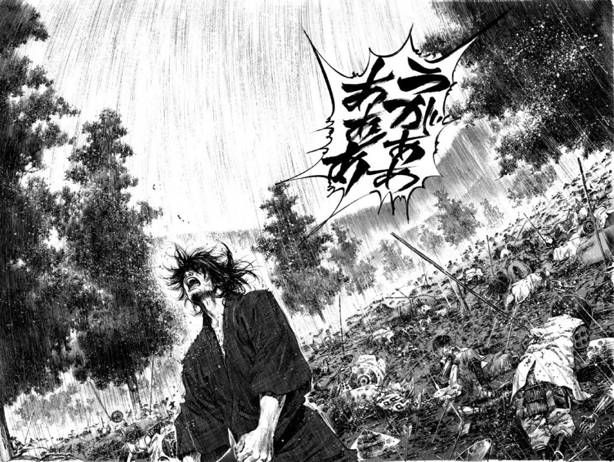

  <!-- Painel Mangá Vagabond (Takehiko Inoue) -->
  

    

  # MATHEUS HENRIQUE
  ### 宮本武蔵の道 • SOFTWARE DEVELOPER

  

    <i>"Preocupado com uma única folha, você não verá a árvore. 
    Preocupado com a árvore, você perderá a floresta inteira."</i> 
    — <b>Miyamoto Musashi (Vagabond)</b>
  

  

    <a href="https://mathz36.github.io/Portifolio/"><code>[ Portfólio ]</code></a> &nbsp;•&nbsp;
    <a href="https://www.linkedin.com/in/matheus-henrique-bb583a235"><code>[ LinkedIn ]</code></a> &nbsp;•&nbsp;
    <a href="https://www.instagram.com/mathz36_"><code>[ Instagram ]</code></a> &nbsp;•&nbsp;
    <a href="mailto:goldenbr6@gmail.com"><code>[ goldenbr6@gmail.com ]</code></a>
  

  
📍 <i>Leopoldina, Minas Gerais — Brasil</i>

---

### ⛩️ Sobre Mim & Filosofia de Código

Desenvolvedor de Software focado no ecossistema **TypeScript / JavaScript**, construindo aplicações de alto desempenho, arquiteturas limpas e sistemas interativos. Inspirado pelo traço visceral dos mangás clássicos: foco absoluto na técnica, refinamento diário de cada função e resiliência constante diante de bugs e desafios complexos.

---

### ⚔️ Projetos Atuais

<table>
  <tr>
    <td width="50%" valign="top">
      <h3 align="center">🎴 Yu-Gi-Oh! Duelist Kingdom Engine</h3>
      

        <b>Simulador Tático de Duelos 3D & Deck Builder Retrô</b>
      

      

        Inspirado no clássico arco do <i>Reino dos Duelistas</i> e no cultuado <i>Forbidden Memories (PS1)</i>. Renderização 3D em tempo real com WebGPU/WebGL2, máquina de estados para turnos de duelo, prioridade tática e 181 testes unitários contínuos.
      

      

        <b>Arsenal:</b> 
        <code>TypeScript</code> • <code>React 18</code> • <code>Three.js (WebGPU/WebGL)</code> • <code>Supabase</code> • <code>Howler.js</code> • <code>Vitest</code>
      

      

        <a href="https://github.com/Mathz36/yugioh"><b>🔗 Acessar Repositório →</b></a>
      

    </td>
    <td width="50%" valign="top">
      <h3 align="center">🛡️ Gideon — Sankhya ERP AI</h3>
      

        <b>IA Generativa Corporativa & RAG Text-to-SQL</b>
      

      

        Plataforma corporativa integrada diretamente ao banco do <b>Sankhya ERP</b>. Converte perguntas em linguagem natural para consultas SQL nativas no PostgreSQL em tempo real via streaming SSE, gerando métricas seguras e dashboards interativos.
      

      

        <b>Arsenal:</b> 
        <code>Google Gemini API</code> • <code>Node.js</code> • <code>Express</code> • <code>TypeScript</code> • <code>Prisma ORM</code> • <code>PostgreSQL</code> • <code>React 19</code>
      

      

        <a href="https://github.com/Mathz36/GIDEON"><b>🔗 Acessar Repositório →</b></a>
      

    </td>
  </tr>
</table>

---

### 📚 Animes & Mangás Favoritos

<table>
  <tr>
    <td width="50%" valign="top">
      <h4>📺 Animes Favoritos</h4>
      <ul>
        <li>🏴‍☠️ <b>One Piece</b></li>
        <li>🍥 <b>Naruto</b></li>
        <li>🦉 <b>The Promised Neverland</b></li>
        <li>⚔️ <b>Kimetsu no Yaiba</b></li>
        <li>🔥 <b>Blue Exorcist</b></li>
      </ul>
    </td>
    <td width="50%" valign="top">
      <h4>📖 Mangás Favoritos</h4>
      <ul>
        <li>🗡️ <b>Vagabond</b> (Takehiko Inoue)</li>
        <li>🛸 <b>Dandadan</b> (Yukinobu Tatsu)</li>
      </ul>
      

        <i>"A determinação inabalável de Luffy, a resiliência ninja de Naruto e a busca solitária de Musashi pela maestria da lâmina refletem a forma como encaro o aprendizado e a engenharia de software."</i>
      

    </td>
  </tr>
</table>

---

### 🛠️ Tecnologias & Arsenal

#### Frontend & Gráficos 3D

 

#### Backend, Banco de Dados & IA

 

#### Ferramentas & Qualidade

---

### 📊 Histórico de Commits & Atividade (Monocromático)

  <!-- Gráfico de Contribuições Nativo em Nanquim Branco -->
  <h4>🗓️ Histórico de Contribuições</h4>
  

    

  <!-- Curva Contínua de Commits em Traço Branco -->
  <h4>📈 Curva de Atividade</h4>
  

    

  <!-- Cards de Streak e Métricas em Tema Escuro Monocromático -->
  

    
    &nbsp;
    
  

  

    
  

---

  
<i>「 天下に無双 」 • Invicto sob o sol</i>

